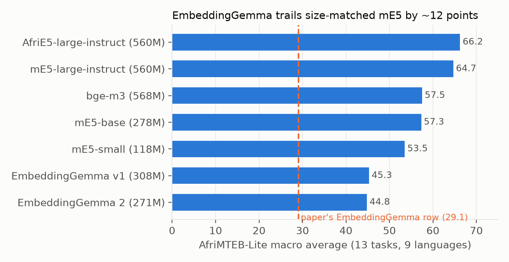
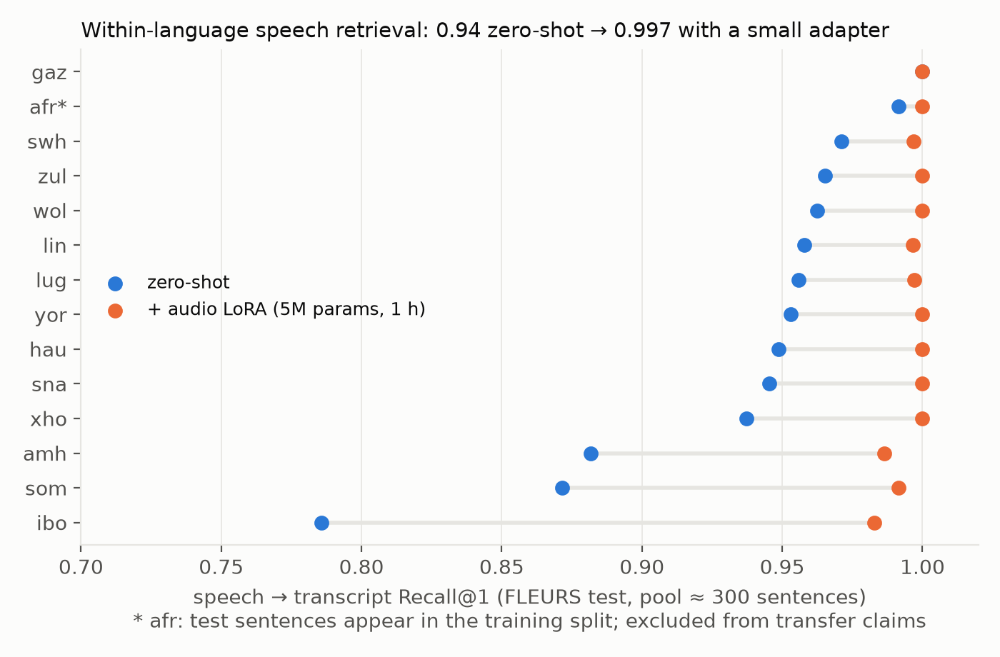
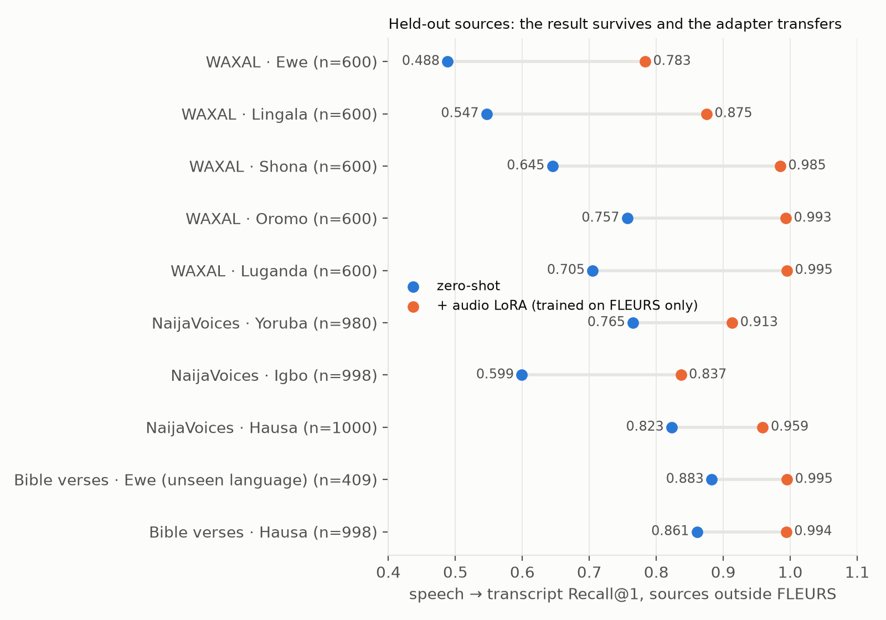
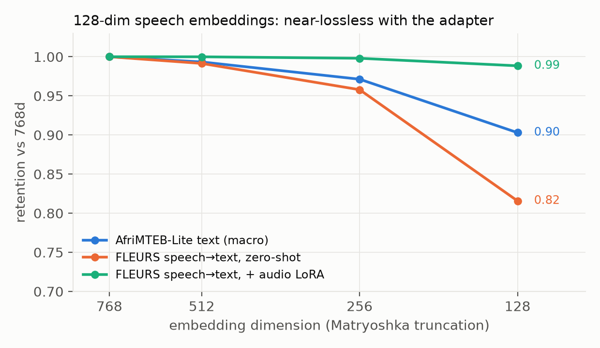
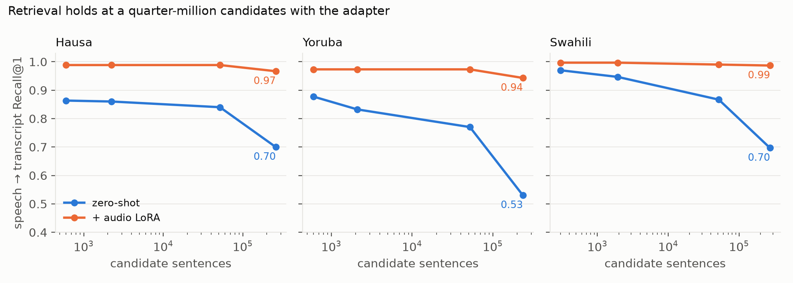
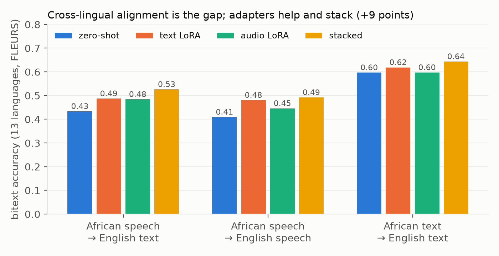

# EmbeddingGemma 2 on African Languages: Corrected Text Benchmarks and Speech Retrieval with a 5M-Parameter Adapter

**Ugochukwu Onyebuchi** · Carnegie Mellon University / NaijaML · pyvinci@gmail.com

*Draft, 2026-10-15. Numbers from `docs/RESULTS.md`; figures in `docs/figures/`.*

## Abstract

We present, to our knowledge, the first systematic evaluation of Google's EmbeddingGemma 2, a 744M-parameter open multimodal embedding
model, on African languages. On text, we re-run the AfriMTEB-Lite benchmark for both EmbeddingGemma generations and five
baselines under one harness and find that the EmbeddingGemma row in the AfriMTEB paper (29.1) does not reproduce: under the model's intended bidirectional attention the macro score is about 45 for both generations (the published row is reproduced by running the model with a causal attention mask), which share a tokenizer and score within 0.5 points of each other (single seed).
They trail a size-matched mE5-base by 12 points, more than half of it on cross-lingual bitext mining, while EmbeddingGemma 2 stays within 5.5 points of 560M-parameter models on sentiment, hate-speech and emotion classification. On speech, EmbeddingGemma 2 retrieves transcripts from
spoken utterances at 0.934 Recall@1 across 21 African languages zero-shot (FLEURS, pools of about 300), with
low-resource languages such as Wolof, Luo and Fulfulde above 0.95. A LoRA adapter with 5M parameters, trained for one
H100-hour on 9,000 speech-transcript pairs from six languages, raises the 14 languages it was evaluated on from 0.938 to 0.997, transfers to seven languages not
seen in training, and makes 128-dimensional embeddings nearly lossless (retention 0.82 to 0.99). Cross-lingual
alignment is the model's consistent weakness: African speech retrieves English text at 0.43, images retrieve
African-language captions at 0.17 versus 0.79 for English, and the same languages that fail these tests fail bitext
mining. Each adapter closes about five points of the cross-lingual gap. We release the harness, all results, and the
adapter. On held-out sources the result survives: Hausa and Ewe Bible verses and NaijaVoices crowd recordings in
Hausa, Igbo and Yoruba score 0.60-0.88 zero-shot and 0.84-0.995 with the adapter, including Ewe, a language in neither
FLEURS nor the adapter's training set. A cascade of a 1B-parameter speech recogniser and the same text embedder reaches
0.990 and beats the zero-shot model by 7 points; the adapted model matches it in one pass, and against 235,000 to
273,000 candidate sentences it still retrieves at 0.94 to 0.99 where the zero-shot model falls to 0.53 to 0.70. Stacking the text and audio adapters is nearly additive, lifting cross-lingual speech retrieval from 0.43 to 0.53. On WAXAL
spontaneous speech in five languages the adapter never saw, it lifts zero-shot retrieval from 0.63 to 0.93.
Four tools built on it (a transcript validator, voice-note and long-form archive search, a cross-corpus leakage
check) run on a 4 GB laptop GPU and are released with the harness.

## 1. Introduction

EmbeddingGemma 2 (released 2026-10-06, Apache 2.0) maps text, images, audio and video into one 768-dimensional space and
is small enough to run on a phone: 271M parameters for text, 577M with audio. That combination targets exactly the
conditions of African-language deployment, where speech often matters more than text and connectivity is poor. Yet the
model card names no African language, and the only prior African-language benchmark result for the family, beyond a few MMTEB tasks in its own report, is a 29.1 macro score
for EmbeddingGemma v1 in the AfriMTEB paper (Uemura, Zhang and Adelani, EACL 2026), with bitext and retrieval scores of 11-18 that point to an evaluation-configuration problem rather than the model's ability.

We ask three questions. (1) What does EmbeddingGemma actually score on African text, under the same harness as its
competitors? (2) Does the audio tower work for African speech? (3) Where does the shared multimodal space hold and where
does it break, and how cheaply can the breaks be repaired?

## 2. Setup

**Harness.** `afriembed`, a single CLI over sentence-transformers 6.1, transformers 5.19 and mteb 2.24, with task
prompts taken from the model's own catalog, bf16 inference, and every result recorded with its prompts, context cap and
library versions. Baselines use mteb's registered model definitions so their published instructions are applied.

**Text.** AfriMTEB-Lite (13 tasks, 9 languages: Amharic, Oromo, Igbo, Yoruba, Hausa, Swahili, Kinyarwanda, Xhosa, Zulu)
and AfriMTEB Full (33 text tasks, 59 languages). Two upstream task definitions needed workarounds (an empty validation
split in EmotionAnalysisPlus; four languages missing from the SIB-200 v2 dataset); both are recorded per run and applied
identically to all models. CIRAL (English queries, 50k-passage pools in Hausa, Somali, Swahili, Yoruba).

**Speech.** FLEURS test for 21 African languages (one recording per sentence, pools of about 300); FLEURS n-way parallel
ids for cross-lingual speech bitext; AfriSpeech-200 for accented English; FLEURS train for fine-tuning. Transcripts carry
the model's `document` prompt; audio carries no prompt.

**Vision.** Afri-Aya image-caption pairs with English and local-language captions.

**Compute.** About 9 H100-hours and 4 A10G-hours on Modal ($42 at list prices), plus a 4 GB laptop GPU for the tools.

## 3. Text: the corrected benchmark

| Model | Params | Macro | Flores bitext | Belebele | MasakhaNEWS | AfriSenti |
|---|---|---|---|---|---|---|
| AfriE5-large-instruct | 560M | 66.2 | 97.9 | 76.4 | 83.5 | 55.1 |
| mE5-large-instruct | 560M | 64.7 | 97.8 | 76.0 | 82.9 | 49.7 |
| bge-m3 | 568M | 57.5 | 85.0 | 69.9 | 76.8 | 51.2 |
| mE5-base | 278M | 57.3 | 91.3 | 62.9 | 74.9 | 51.3 |
| mE5-small | 118M | 53.5 | 82.8 | 53.0 | 73.4 | 46.9 |
| EmbeddingGemma v1 | 308M | 45.3 | 42.1 | 54.9 | 75.0 | 44.2 |
| EmbeddingGemma 2 | 271M | 44.8 | 39.5 | 51.8 | 75.0 | 49.7 |

Three results. First, the published v1 score of 29.1 does not reproduce: on the paper's own 12 tasks we obtain 45.0,
with Belebele 54.9 vs 10.6, Flores 42.1 vs 12.2 and NTREX 49.0 vs 17.9. Disabling task prompts costs only 1-2 points
and running at the model's full 2K context moves the macro by 0.1, so neither explains the published numbers. Running the model with a causal
instead of bidirectional attention mask, which is what a transformers release that ignores EmbeddingGemma's
`use_bidirectional_attention` flag does, reproduces the published row: 30.5 vs 29.1 on the paper's 12 tasks (32.0 vs 31.6 without the non-comparable SIB-200 v2), Flores
14.0 vs 12.2, NTREX 20.1 vs 17.9, SIB-200 29.5 vs 29.6 (full table in RESULTS.md). fp32 (45.0), fp16 (all NaN) and a
128-token limit (44.1) do not. The causal fallback is already a known bug (sentence-transformers issue #3725,
mteb issue #3144); what is new is evidence that it is the likely cause of the AfriMTEB row. We have shared these findings with the AfriMTEB authors; they have not yet confirmed their original setup. Second, v2 equals v1 on African text (44.8 vs
45.3; 52.0 vs 52.6 on the Full suite). Tokenizer fertility is identical to the decimal across 30 languages, indicating the tokenizer did not change. Third, the gap to mE5 is concentrated: against mE5-base, bitext mining is 40-47 vs 89-91 and clustering 14 vs 20 (44 for mE5-large-instruct), while sentiment, hate speech and emotion are within 5.5 points of the 560M-parameter models and news is within 2 of bge-m3.

Matryoshka truncation retains 0.99 / 0.97 / 0.90 of the macro at 512 / 256 / 128 dimensions. Vocabulary trimming to the
23k tokens used by the nine languages plus English removes 245 MB (bf16) but costs five macro points.

## 4. Speech: zero-shot and adapted

Zero-shot speech-to-transcript Recall@1 averages 0.934 over 21 languages. Resource tier barely predicts the outcome (mean 0.94 for low-resource, 0.91 mid, 0.97 high):
Wolof 0.962, Luo 0.974, Fulfulde 0.964 and Kabuverdianu 0.985 are low-resource, while the weakest are Igbo 0.786,
Umbundu 0.806, Somali 0.871, Kamba 0.879 and Amharic 0.882. Removing the `document` prompt from transcripts costs up to 23 points, most for Somali (23) and Igbo (13). On African-accented English (AfriSpeech-200, 108 accents, 1,967 utterances, full pool)
Recall@1 is 0.888, with no clinical-versus-general penalty.

A rank-16 LoRA on the text tower's projections (5.0M parameters), trained with cached contrastive loss on 9,000 FLEURS
train pairs from Hausa, Yoruba, Swahili, Amharic, Igbo and Somali for one epoch, raises the mean over the 14 evaluated languages from 0.938 to 0.997 (0.996 without Afrikaans); retraining with two more seeds, which change the LoRA initialisation and data order, gives 0.9964-0.9965, with 128-dimensional retention of 0.988-0.989.
Gains concentrate where the base was weakest (Igbo +20, Amharic +10, Somali +12) and transfer to seven languages absent
from training (Xhosa, Zulu, Wolof, Luganda, Lingala, Shona, Oromo reach 0.99-1.00; Oromo has only 36 test clips). Training and test sentences are disjoint across languages: FLEURS shares sentence ids between languages, so we checked the test sentences of all 21 languages, the six training languages included, against the 1,509 FLORES sentence ids in the training data, and found no overlap in 20 of them. The exception is Afrikaans, whose 233 test sentences all occur in the other languages' training split, so it is excluded from every transfer claim (`scripts/check_fleurs_overlap.py`). Unfreezing the 306M
audio tower adds 0.001. The adapter also repairs low-dimensional embeddings:

To reduce the risk of FLEURS leakage we evaluate on sources outside FLEURS and outside the adapter's training data (Google has not published the base model's training data): BibleTTS verses in Hausa (pool 998)
and Ewe (409; Ewe is in neither FLEURS nor the adapter's training languages), and NaijaVoices crowd recordings in Hausa,
Igbo and Yoruba (pools of about 1,000, clips of 3-4 s). Zero-shot Recall@1 is 0.861, 0.883, 0.823, 0.599 and 0.765; with
the adapter 0.994, 0.995, 0.959, 0.837 and 0.913.

### Cascade baseline and scale

Two checks a reviewer would ask for. First, a cascade of Meta's MMS-1B-all speech recogniser and the same text embedder
retrieves at 0.990 mean Recall@1 across ten languages despite 15 to 54 percent word error rate, beating the zero-shot
direct path (0.924) by 7 points and by 20 on Igbo; the adapted direct path (0.995) matches or beats the cascade in nine of
ten languages (Amharic 0.986 vs 1.000) in one pass, with no 1B-parameter recogniser and no transcript. Second, retrieval survives scale: against pools
of 235,000 to 273,000 same-language sentences built from FLEURS, NaijaVoices and CIRAL news, the adapted model scores
0.967 (Hausa), 0.943 (Yoruba) and 0.987 (Swahili) at Recall@1, where the zero-shot model falls to 0.70, 0.53 and 0.70.

### WAXAL spontaneous speech (released February 2026)

WAXAL ASR test shards (community mirror), 600 spontaneous image-prompted clips of 17-24 s per language, pools of 600, five
languages absent from the adapter's training: zero-shot R@1 Luganda 0.705, Oromo 0.757, Shona 0.645, Lingala
0.547, Ewe 0.488 (mean 0.63); with the adapter 0.995, 0.993, 0.985, 0.875, 0.783 (mean 0.93; 0.926-0.928 over three training seeds, Ewe 0.782-0.787). Spontaneous
speech is much harder than FLEURS read speech for the zero-shot model, and the adapter trained on six other
languages' read speech recovers most of the gap.

### Tools built on the adapter

All measured in docs/RESULTS.md "Tools", all on an RTX 3050 4 GB. (1) Transcript validator: 251/251
injected wrong labels caught across NaijaVoices Hausa, BibleTTS Hausa and WAXAL Luganda as hard fails at 0.93-1.00 precision (at most 0.9% of clean clips failed; 1-8% flagged for review when borderline clips are counted); one genuine NaijaVoices label error surfaced. (2) Voice-note search: another
reader's recording of the same sentence retrieved at 0.996 R@1 over six languages. (3) Archive search: 23 min of
continuous Hausa speech as 10 s windows, spoken query finds the window at 0.81 top-1 / 0.98 top-3. (4) Leakage
check: precision 1.00, recall 0.95 on a positive control, no false positives across three corpora. Also released:
Spoken AfriQA (negative: 0.19 R@1 spoken vs 0.82 typed English, the African-to-English direction; the Igbo TTS voice is largely unintelligible: its clips retrieve their own text at only 0.28) and Spoken
Injongo intent routing (spoken Hausa 0.80 vs typed 0.92 over 40 intents), both with synthetic MMS-TTS queries, plus a zero-ASR aligner for long read
audio (RESULTS.md "Tools", P6).

## 5. Where the shared space breaks: cross-lingual alignment

Over 13 languages, recordings that retrieve their own transcript at 0.93 retrieve the English translation at only 0.43,
and English speech at 0.41. Only Swahili (0.72) and Amharic (0.63) are well aligned; most languages sit at 0.33-0.45 and
African-African pairs average 0.34. The failure is in the text space: text-to-text bitext is 0.60 on the same pairs,
Afri-Aya images retrieve their English caption at 0.79 but their local caption at 0.17, and local and English captions of
the same image match at only 0.07-0.19 for nine of the twelve Afri-Aya languages (the others: Igbo 0.38, Egyptian Arabic 0.96, Krio 0.84). On
CIRAL passage retrieval, by contrast, EmbeddingGemma 2 (0.380 nDCG@20) ties mE5-base (0.379); topical overlap suffices
for passages where exact alignment does not for sentences.

Two cheap interventions each recover about five points of cross-lingual speech: the audio adapter (0.434 to 0.484) and a
text-side LoRA on 45k caption translation pairs (0.434 to 0.487). Activating both adapters together is nearly additive (0.526, a 9.2-point gain against 10.3 for the two separately; text-to-text 0.644), with every language improving. The text adapter does not improve AfriMTEB-Lite
(44.9 to 44.0 at the same 1K-token context) and hurts intent classification, so caption pairs are too small and too narrow a signal; a fine-tune on
real parallel corpora is the natural next step, and because audio inherits the text space, it should lift speech
cross-lingually as well.

## 6. Other findings

Spoken language identification from raw embeddings reaches 0.67 5-NN accuracy over 21 languages (chance 0.048), with
Zulu/Xhosa the dominant confusion. The Gemma tokenizer spends 1.95x as many tokens per word on African languages as on
English, against 1.66x for XLM-R and 1.33x for NLLB; Zulu, Xhosa and Tigrinya cost 2.6-2.7x. Fragmentation does not predict bitext quality (Pearson r = -0.21 against text bitext over 13 languages).

## 7. Limitations

FLEURS is public and may be in the audio encoder's training data; the held-out evaluation on NaijaVoices and BibleTTS
(Section 4) reduces this risk, though its pools are still around 1,000. Most retrieval pools are small (about 300); the
large-pool test covers three languages up to 273,000 candidates and the others are untested at that scale. The
cascade baseline uses one recogniser (MMS-1B-all) with greedy decoding; a stronger recogniser or language model
rescoring would raise it. Baselines re-run through mteb score about 3 points above the paper on its 12-task macro, mostly from SIB-200 v2 (four languages missing upstream) and from Flores, NTREX and AfriSenti; rankings are unaffected. Two
AfriMTEB-Lite languages (Kinyarwanda, Oromo) have little or no FLEURS audio. The adapter was trained with three seeds; every other result comes from a single run.

## 8. Conclusion

EmbeddingGemma 2 is a weak cross-lingual aligner for African languages but a middling within-language text embedder, and its
audio tower works for African speech out of the box. For on-device voice search in a single language the zero-shot
model is usable but is beaten by a conventional recogniser-plus-embedder cascade; a 10 MB adapter closes that gap in a
single pass, is near-perfect on FLEURS, including seven languages it never saw, reaches 0.78–0.995 on held-out recordings, and holds up at indexes of a
quarter-million sentences. Cross-lingual use needs a real parallel-data fine-tune, which the results here suggest will carry over to speech.

## Artifacts

- Harness, results and figures: this repository (`afriembed`).
- Audio adapter: https://huggingface.co/naijaml/embeddinggemma-2-african-speech-lora (also in `artifacts/audio-lora`).
- Raw per-run JSON with prompts, versions and caveats: `results/`.
